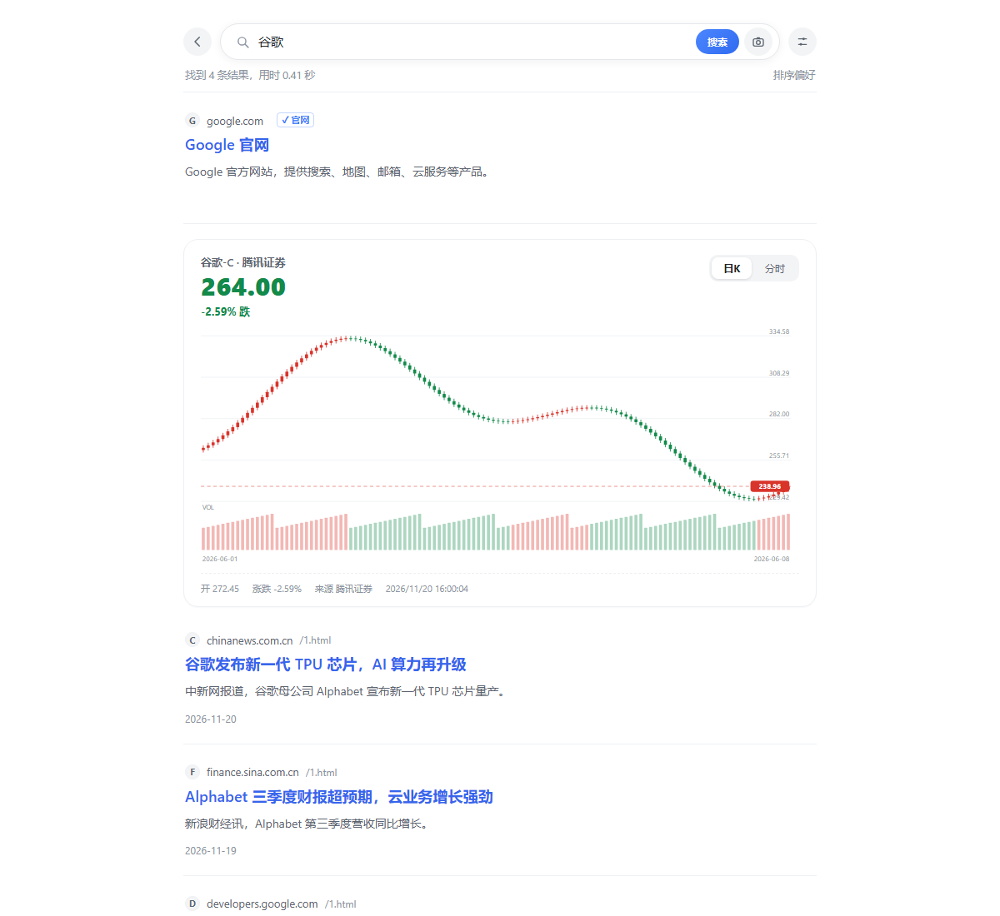
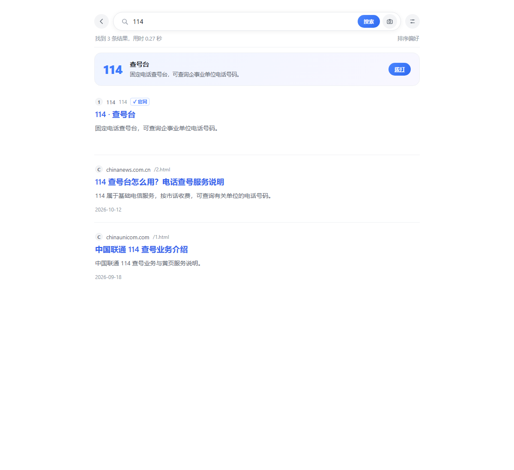
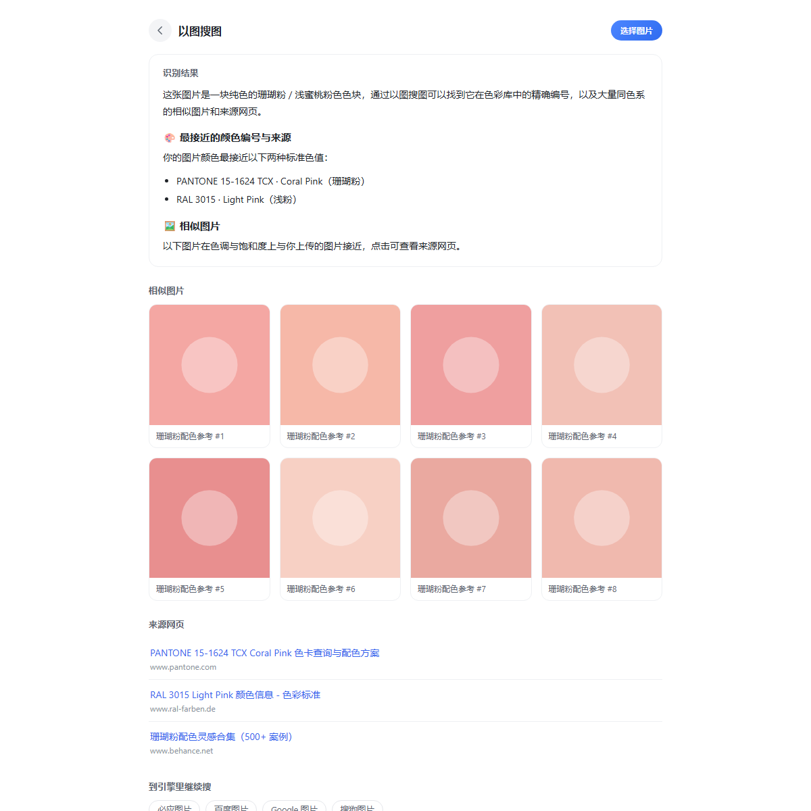
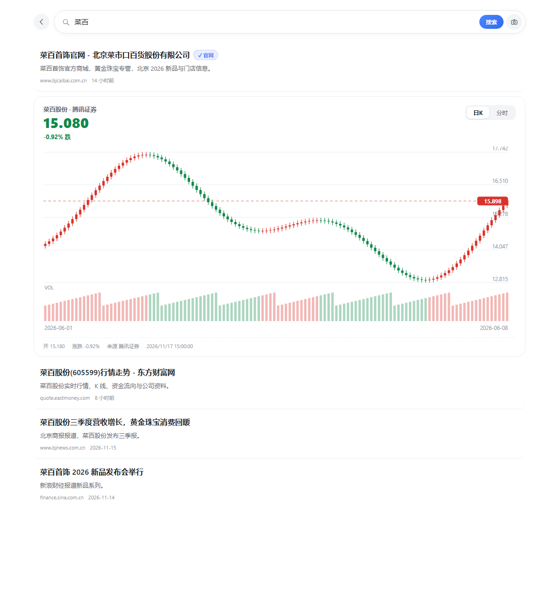
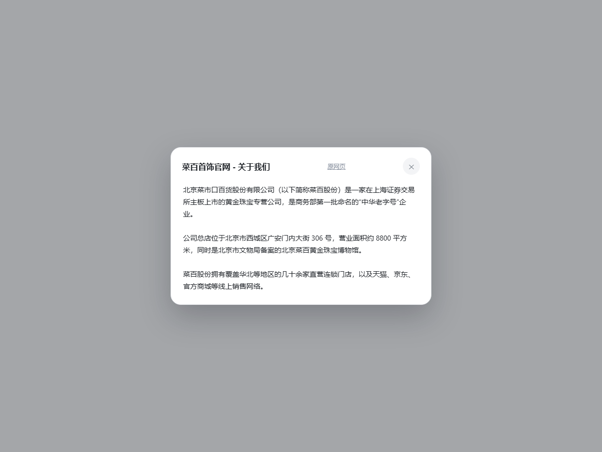

# 清爽搜索 · dsh-clean-search

给 [DeepSeek Harness](https://github.com/deepseek-ai/deepseek-harness) 用的**无广告搜索首页**插件：搜索结果官网优先、竞价广告降权，并把天气、行情走势、特殊号码与以图搜图收进同一个搜索页。


## 功能

- **无广告搜索**：DeepSeek Search API，结果按「考试官方 > 品牌/权威官网 > 其他」排序；内置广告域名库与营销文案特征，竞价/培训/医疗广告降权并打标
- **公司官网置顶 + 行情配合**：搜索有股票行情的公司（A 股 / 港股 / 美股）时，公司官网固定第一条，行情 K 线/分时紧随其后，新闻等其他内容排在后面；A 股任意公司通过东方财富公开公司资料自动反查官网（如「伊利股份」→ yili.com）
- **品牌与地区别名**：内置 116 条品牌/服务官网映射（菜百、谷歌、智谱、知网、知乎、12306…），支持地区站点别名（日亚 / 日本亚马逊 → `amazon.co.jp`）
- **行情直连**：股票 / 外汇 / 期货 / 指数实时报价 + 日 K + 分时；中文公司名自动识别（「腾讯控股」→ 港股 00700）；纯数字查询只认完整 6 位 A 股代码（000002 → 万科 A）
- **特殊号码**：36 个常用号码（110 / 119 / 120 / 114 / 12306 / 12345 / 12315 / 95588 / 10086 / 顺丰…），支持「纯号码」「号码 + 客服」「品牌 + 客服电话」三种识别；号码卡片带官网或拨打按钮
- **天气**：Open-Meteo 免 key，含空气质量、穿衣指数、15 日预报、城市切换（本地记忆）
- **以图搜图**：DeepSeek 联网图搜 + 多引擎兜底链接；大图上传前自动压缩；识别结果按 Markdown 排版、相似图为网格、来源网页为列表
- **搜索体验**：搜索历史与联想（↑↓ / Tab）、6 小时结果缓存、URL 规范去重、失败可读提示、今日搜索用量统计、阅读模式、排序权重滑杆
- **深色模式**自适应

## 截图

| 首页 | 搜索结果：公司官网 + 行情 |
|---|---|
|  |  |

| 特殊号码 | 以图搜图 |
|---|---|
|  |  |

| 官网优先（品牌） | 天气详情 |
|---|---|
|  |  |

| 阅读模式 | |
|---|---|
|  | |

## 安装

需要已安装 DeepSeek Harness（0.2.x）。

本地目录安装（开发用）：

```bash
dsh plugin --profile desktop add link:<path-to-this-repo>
```

也可以在 DSH 的「插件 → 添加插件」里选择本目录，或通过 plugin_manager 安装。

安装后完全退出 DSH 重开，左侧栏会出现「清爽搜索」。

## 配置

`cordis.patch.yml` 的 `config`：

| 字段 | 默认 | 说明 |
|---|---|---|
| `city` | 上海 | 首页默认城市 |
| `count` | 10 | 默认搜索结果条数 |
| `cacheSeconds` | 21600 | 搜索结果缓存时长（秒） |
| `officialOverrides` | `{}` | 自定义「名称 → 官网」映射，如 `{ "某平台": "example.com" }`，可补充品牌表未收录的站点 |

## 凭据

搜索与图搜复用 DSH 的凭据服务（`DEEPSEEK_API_KEY`），不需要额外配置 key。

## 架构

- Host 半：`index.js`（ESM），注册 `/dsh-clean-search/api/*` 路由（search / home / quote / kline / image-search / read / usage / status）
- 浏览器半：`client/client.js`，手写 `window.__ModuleLoader__` 线格式，只 `require('react')`
- 本地数据：`$DSH_HOME/clean-search/`（搜索缓存与用量 JSONL）
- 无外部依赖，仅用 Node 内置模块

## 已知限制

- 依赖 DeepSeek Search API（按次计费），失败时降级到 DSH 的 `ctx.web` 搜索
- 行情与天气来自公开接口，可能受网络环境影响
- 美股只有日 K（腾讯接口不提供美股分时）；A 股与港股有分时
- 纯数字查询只识别完整 6 位 A 股代码；港股 5 位代码请用中文名 / 英文名搜索（如「腾讯控股」）
- 品牌官网表覆盖常见站点，未收录的站点可用 `officialOverrides` 自行补充

## License

MIT © perfectnym
