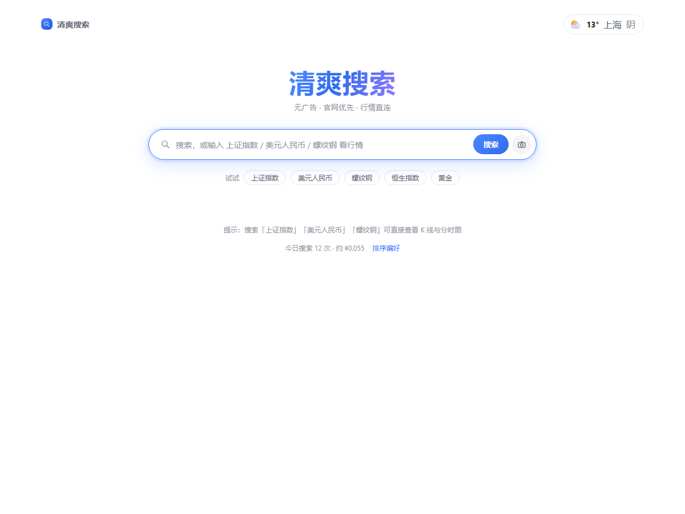
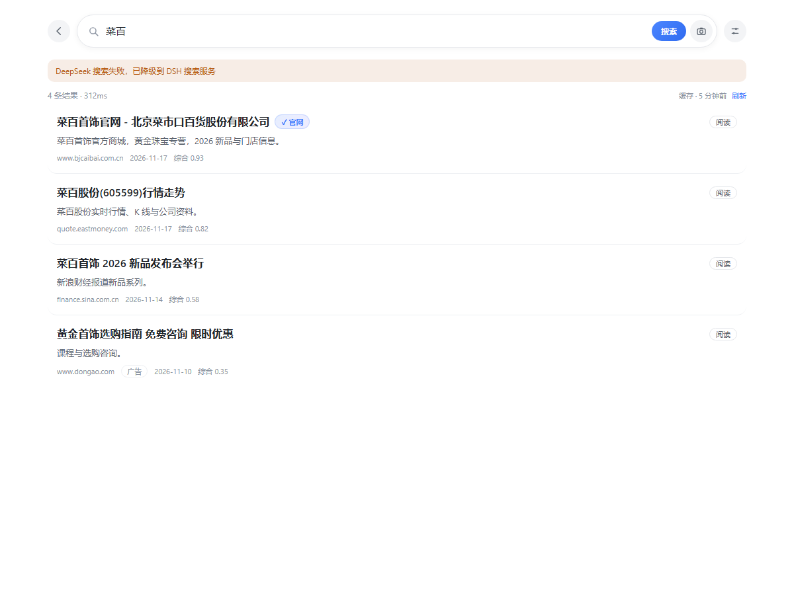
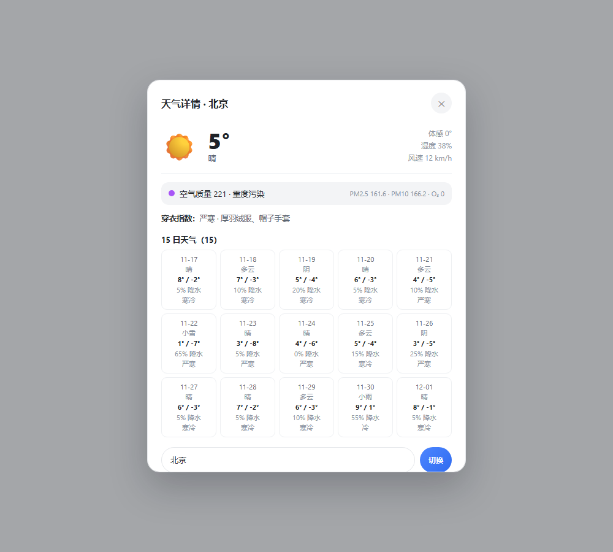

# 清爽搜索 · dsh-clean-search

给 [DeepSeek Harness](https://github.com/deepseek-ai) 用的**无广告搜索首页**插件：一个搜索框，搜索结果官网优先、竞价广告降权，附带天气、行情走势与以图搜图。



## 功能

- **无广告搜索**：走 DeepSeek Search API，结果按「考试官方 > 品牌/权威官网 > 其他」排序；内置广告域名库与营销文案特征，竞价/培训/医疗广告降权并打标
- **官网优先**：内置常见品牌公司简称映射（菜百 → 菜百首饰官网、iPhone → apple.com…），搜索结果没召回官网时自动补一条官方入口
- **行情直连**：搜索股票/外汇/期货/指数或公司简称时，直接出实时报价 + 日 K + 分时（腾讯 / 新浪公开接口）
- **天气**：Open-Meteo 免 key，含空气质量、穿衣指数、15 日预报、城市切换（本地记忆）
- **以图搜图**：DeepSeek 联网图搜 + 多引擎兜底链接；大图上传前自动压缩
- **搜索体验**：搜索历史与联想（↑↓ / Tab）、6 小时结果缓存、URL 规范去重、失败可读提示、今日搜索用量统计
- **阅读模式**：结果页站内提取正文，不用跳浏览器
- **排序偏好**：相关性 / 时效 / 官网优先三个滑杆，按需调整
- **深色模式**自适应

## 截图

| 首页 | 搜索结果 |
|---|---|
|  |  |

| 结果页（官网 + 行情） | 以图搜图 |
|---|---|
|  |  |

| 天气详情 | 阅读模式 |
|---|---|
|  |  |

## 安装

需要已安装 DeepSeek Harness（0.2.x）。

本地目录安装（开发用）：

```bash
dsh plugin --profile desktop add link:<path-to-this-repo>
```

也可以在 DSH 的「插件 → 添加插件」里选择本目录，或通过 plugin_manager 安装。

安装后完全退出 DSH 重开，左侧栏会出现「清爽搜索」。

## 配置

`cordis.patch.yml` 的 `config`：

| 字段 | 默认 | 说明 |
|---|---|---|
| `city` | 上海 | 首页默认城市 |
| `count` | 10 | 默认搜索结果条数 |
| `cacheSeconds` | 21600 | 搜索结果缓存时长（秒） |

## 凭据

搜索与图搜复用 DSH 的凭据服务（`DEEPSEEK_API_KEY`），不需要额外配置 key。

## 架构

- Host 半：`index.js`（ESM），注册 `/dsh-clean-search/api/*` 路由（search / home / quote / kline / image-search / read / usage / status）
- 浏览器半：`client/client.js`，手写 `window.__ModuleLoader__` 线格式，只 `require('react')`
- 本地数据：`$DSH_HOME/clean-search/`（搜索缓存与用量 JSONL）
- 无外部依赖，仅用 Node 内置模块

## 已知限制

- 依赖 DeepSeek Search API（按次计费），失败时降级到 DSH 的 `ctx.web` 搜索
- 行情与天气来自公开接口，可能受网络环境影响
- 以图搜图受模型速度影响，大图已自动压缩，仍可能偶发超时

## License

MIT © perfectnym
